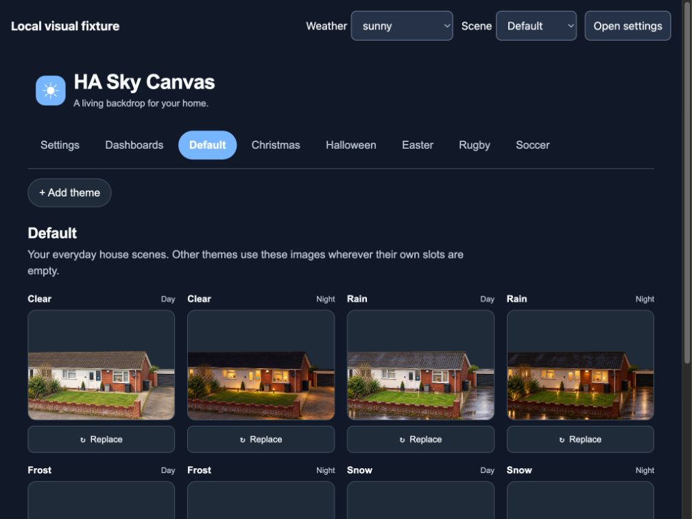

# HA-Sky-Canvas

Weather and seasonal house scenes behind your Home Assistant dashboards. A locally rendered sky, a transparent house image and animated weather form three decorative layers beneath the dashboard controls.

Default and Christmas house scenes are included so you can see it working immediately. Replace them with your own house, choose the dashboards where they appear, and schedule additional themes from the **Sky Canvas** settings page.

Version 0.2.0 was checked on Home Assistant Core 2026.10.4 with live current/hourly/daily forecasts, dashboard banners, native Energy and Map, phone/tablet layouts, keyboard forecast scrolling and Light/Auto appearance. Refresh existing browser pages after updating. The original scene, upload, explicit-save and seasonal-setting checks remain the 0.1.0 baseline. The frontend adapter uses Home Assistant internals, so future frontend versions require compatibility checks.



Theme settings shown in the local development preview with demonstration data and the included Default images.

## Features

- Standard Home Assistant weather entity and `sun.sun` for conditions and day/night.
- Eight fixed house slots per theme: Clear, Rain, Frost and Snow, each Day/Night. More weather animations share those slots.
- Default, Christmas, Halloween, Easter, Rugby and Soccer tabs, plus custom themes. Default and Christmas are populated; other themes start blank.
- Christmas annually from **1 December through 5 January**, inclusive in Home Assistant's timezone. Other themes support annual or one-off dates, enable switches and explicit priority for overlapping schedules.
- Selected dashboards, initially Overview, or all Lovelace dashboards. Energy, Map and other non-dashboard panels retain their own presentation.
- Explicit saves, with Save/Discard/Stay when changing tabs with edits. Separate browser sessions cannot silently overwrite a newer revision.
- Reduced motion support, hidden-page animation pause and bounded rendering work for tablets. Lightning flashes are off by default.
- Optional Met Office current, hourly and daily cards with all 30 official condition symbols, temperature colours, UV categories and explicit missing-data states.
- Optional weather and flood warning banners across supported dashboards, independently of the decorative background selection. Each authority retains its own severity, scope and advice.

Missing seasonal images fall back to the matching Default slot. Empty Default slots show no house. Rain and snow take precedence over the optional frost image. Unknown weather produces a neutral sky rather than pretending conditions are clear.

## Install

Requires HACS and Home Assistant 2026.10.2 or newer. Install as an **integration**; it also supplies optional Lovelace cards.

1. In HACS, add `https://github.com/nathcymru/HA-Sky-Canvas` as a custom repository, category **Integration**.
2. Download HA Sky Canvas and restart Home Assistant.
3. Open **Settings → Devices & services → Add integration → HA Sky Canvas** and choose your weather entity.
4. Open **Sky Canvas** in the sidebar. Under Settings, select all dashboards or choose individual dashboards in the Dashboards tab, then save.
5. Open a selected dashboard. Refresh the browser after an update if it retains the previous frontend module.

For manual installation, copy `custom_components/ha_sky_canvas` into your Home Assistant configuration, then follow steps 2–5. Backgrounds and settings need no separate frontend resource or external image service. Register the module below when using the optional Lovelace cards.

## Images and themes

Use **Replace** on a populated slot or **Upload image** on a blank slot to upload a PNG, JPEG or WebP. A transparent sky in a PNG or WebP lets the animation show through. The house is contained, centred horizontally and anchored at the bottom; a 16:9 transparent composition works well. Dashboard cards can cover portions of the background.

Uploads are limited to 12 MiB, 16 megapixels and 8,192 pixels on either side. Animated uploads are rejected. Images are decoded, stripped of metadata and stored as PNGs; previews are generated locally. Uploads remain staged until that tab's **Save Changes** is pressed. Unused uploads are removed after 24 hours, with a 512 MiB upload-storage limit.

Settings and custom images live outside the integration folder, so integration updates preserve them. Include `.storage/ha_sky_canvas` and `ha_sky_canvas/images` in recovery backups. Image access requires Home Assistant authentication; changes and uploads require an administrator.

The bundled AI-generated house images are included with the owner's permission. Original bytes and source manifest are retained. The source set has small framing/alignment differences and tiny source markers at the extreme upper right; these are preserved rather than silently edited.

## Optional frost display

Choose a binary sensor representing **current frost risk** under Settings. An overnight prediction should be a separate warning. The renderer itself does not request forecasts or calculate frost.

The [Met Office example](examples/README.md) supplies a Home Assistant package and shared template for a sun-synchronised estimate: air temperature ≤4°C, wind <8 km/h, `clear-night`, and temperature/dew-point spread ≤3°C. It calculates dew point from the same period's temperature and humidity. This is a heuristic, not a measurement of ground temperature or a guarantee that frost will or will not occur.

## Met Office weather cards

The optional `custom:ha-sky-canvas-weather-card` uses the separate [Met Office Direct integration](https://github.com/nathcymru/ha-metoffice-direct). It preserves the provider's exact weather codes, including showers, drizzle, overcast and day/night variants. The 30 official SVGs are bundled locally in their original colours; viewing a card makes no image request to the Met Office.

Register `/ha_sky_canvas/sky-canvas.js?v=0.2.0-2` as a **JavaScript Module** in **Settings → Dashboards → Resources** before adding either weather card or the forecast map. Use the same URL as the installed integration's frontend module. This ordinary Lovelace resource ensures a fresh direct dashboard load can discover the cards.

```yaml
type: custom:ha-sky-canvas-weather-card
entity: weather.metoffice_direct
mode: current
compact: true
title: Current weather
```

For forecasts, use `mode: hourly` or `mode: daily`; `limit` controls the number of visible periods. Hourly defaults to 48 and permits 1–72; daily defaults to 7 and permits 1–10. The provider may supply fewer periods. For example:

```yaml
type: custom:ha-sky-canvas-weather-card
entity: weather.metoffice_direct
mode: hourly
limit: 6
title: Next six forecast periods
```

Current weather is labelled as a model estimate. Forecast tables include text descriptions, temperature, precipitation chance, wind, gust and UV; daily rows distinguish day weather/highs from the following night's weather/lows. Tables scroll horizontally on narrow screens and use Home Assistant's timezone and converted units. Missing measurements remain dashes, and unavailable or stale data does not become clear weather or zero rain. Daily provenance is separate from current/hourly provenance.

Temperature backgrounds and UV categories follow the published Met Office palette and [forecast guide](https://weather.metoffice.gov.uk/guides/what-does-this-forecast-mean). Numeric values remain in your selected HA units; temperature colour selection uses the nearest Celsius degree, saturating outside the published -19°C to 40°C range. Black or white text provides at least 4.5:1 contrast against every included numeric-band background. UV labels accompany the colours, and gusts at 25 knots or 29 mph are bold. These are numeric-band checks, not an accessibility certification of an entire dashboard.

The [Global Spot parameter glossary](https://datahub.metoffice.gov.uk/docs/glossary?sortOrder=ALPHABETICALLY&models=mo-spot-1hr) defines the API data periods. Hourly precipitation amount covers the **previous hour**, while precipitation chance covers the hour centred on the validity time. The supplied `windGustSpeed10m` is the maximum three-second mean during the preceding ten minutes; it is not the separate hourly maximum-gust parameter. Weather symbols combine conditions at the validity time with recent-period information. Daily precipitation chance covers local dawn to dusk, and the midday gust covers its preceding ten minutes. The card explains these API periods alongside the forecast; it does not apply the public forecast website's period-start convention to Global Spot data. Cards use Home Assistant's forecast subscription and the provider's existing data, so adding cards does not issue additional Met Office API requests.

The [symbol manifest](custom_components/ha_sky_canvas/frontend/weather-icons/v1/manifest.json), [palette provenance](custom_components/ha_sky_canvas/frontend/weather-icons/v1/palette-source.json), [API timing provenance](custom_components/ha_sky_canvas/frontend/weather-icons/v1/data-periods-source.json) and [source/licence notes](custom_components/ha_sky_canvas/frontend/weather-icons/v1/SOURCE.md) record the original URLs, digests, colours and presentation adaptations.

## Weather and flood warning banners

In **Sky Canvas → Settings**, enable **Show warning banners across dashboards**, choose the Met Office warning-level sensor and/or the NRW Flood Direct warning sensor, then save. The banners appear above supported Lovelace and Energy dashboard content, including dashboards without a selected house scene. Panels without a compatible dashboard view retain their own presentation.

Met Office weather warnings and **Natural Resources Wales flood warnings are separate authorities and feeds**. Weather colours preserve the provider's yellow/amber/red classification. NRW flood alert, flood warning and severe flood warning retain their distinct labels and action text; the two higher flood levels share NRW's published red. These rows use published website accent colours with original warning symbols, not agency logos or copied warning graphics.

Each row identifies its source and affected area, distinguishes issued upcoming weather warnings from active warnings, and links to official advice. Regional weather fallback and Wales-wide flood coverage are explicit. A fresh empty feed hides its row; missing, stale or inconsistent data shows an unavailable/out-of-date message. An empty list does not establish that there is no weather or flood risk. Details support keyboard navigation, and updates do not move focus.

The banners read existing Home Assistant entities and make no provider requests. [Implementation and colour provenance](src/alerts/README.md) document the supported data contract and bounded frontend compatibility. Official guidance: [Met Office warnings](https://weather.metoffice.gov.uk/guides/warnings) and [Natural Resources Wales flood advice](https://naturalresources.wales/flooding/what-to-do-in-a-flood/?lang=en).

## Met Office forecast map

An optional Lovelace card plays the direct Met Office integration's cached precipitation frames. It shows actual published forecast times, the model run, a time slider and Play/Pause controls. It starts paused, stops when hidden, supports keyboard controls and follows Home Assistant's timezone. Failed or outdated data is labelled explicitly.

Use the same frontend resource registered for the weather cards above.

```yaml
type: custom:ha-sky-canvas-forecast-map
entity: sensor.metoffice_direct_forecast_map
title: Precipitation forecast
```

This requires the separate [Met Office Direct integration](https://github.com/nathcymru/ha-metoffice-direct) and a configured Map Images precipitation order. It is a forecast, not live radar. The backend discovers valid frames, selects one consistent model run, enforces the shared API allowance and serves authenticated local images. Opening additional dashboards or playing the animation does not make more Met Office requests. No WMS endpoint or browser-visible API key is used.

## Development

Node.js 24 and Python 3.14 are used for the current Home Assistant target.

```sh
npm ci
npm run typecheck
npm test
npm run build
python -m pip install homeassistant==2026.10.4 pytest==9.2.0 pytest-asyncio==1.4.1 ruff==0.17.0 Pillow==12.3.0
python -m pytest
ruff check custom_components tests/python
ruff format --check custom_components tests/python
```

The committed browser bundle is built from `src/`; runtime assets are contained within the integration folder for HACS distribution. Tests cover schedules, timezone boundaries, image fallback, dashboard filtering, draft conflicts, rendering cleanup, access control, upload validation, persistent storage and frost boundary/missing-data cases. Weather-card tests also cover code mapping, asset integrity, unit handling, numeric-band contrast, missing/stale forecasts and subscription cleanup; warning tests cover severity, scope, freshness and lifecycle behavior.

The dashboard adapter depends on Home Assistant frontend structure. It stops mounting if the expected structure is absent, leaving dashboard controls available. Frontend upgrades require live compatibility checks; unit tests do not establish visual acceptance on every device.

## Credits and licence

Application code is MIT licensed; third-party assets retain their own terms. The animation engine derives from [Teuchezh Nurbiy's Dynamic Weather Card](https://github.com/teuchezh/dynamic-weather-card/tree/v2026.10.2/src/animations), version `v2026.10.2`. The full original animation snapshot, original licence and pinned provenance are retained in [`vendor/dynamic-weather-card`](vendor/dynamic-weather-card); the production refactor is in [`src/renderer`](src/renderer). Original copyright notices are retained in the distribution.

The frontend also bundles Lit under BSD-3-Clause. Exact package versions and full licence terms are included in [`THIRD-PARTY-NOTICES.txt`](custom_components/ha_sky_canvas/THIRD-PARTY-NOTICES.txt), inside the HACS integration distribution.

Official Met Office condition symbols and published forecast colours are reused under the [Met Office public website terms](https://www.metoffice.gov.uk/policies/tandc): **Contains public sector information licensed under the [Open Government Licence v3.0](https://www.nationalarchives.gov.uk/doc/open-government-licence/version/3/).** These assets are excluded from the application's MIT licence. Symbols remain unchanged; the numeric-band text treatment is adapted for contrast. Met Office data attribution appears separately as **Powered by Met Office data**. NRW flood information retains its own source attribution. This project is independent and is not endorsed by either authority.

Weather data comes from your selected Home Assistant integration. The separate Met Office example uses **Powered by Met Office data** attribution. Sky Canvas includes no API keys, location-specific configuration, remote telemetry or paid service requirement.
